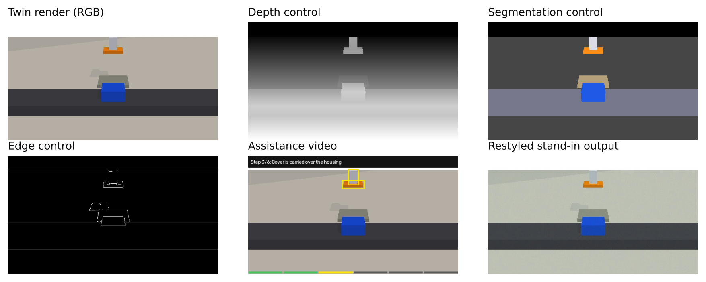
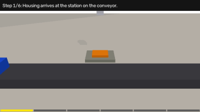
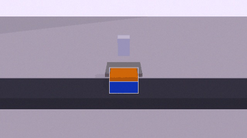
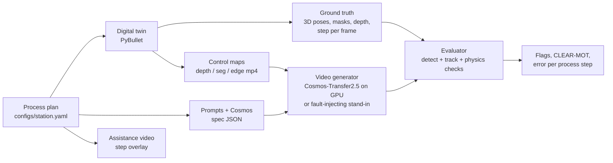
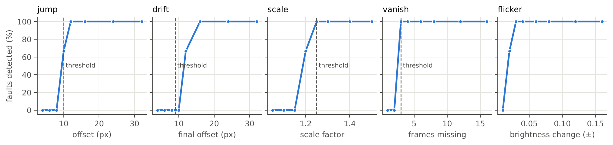
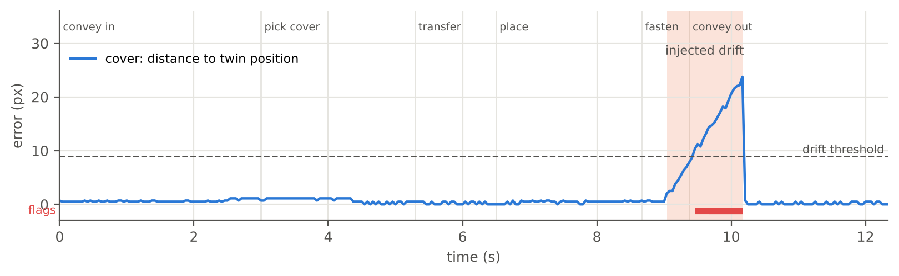

# twin2video-plausibility

**Does an AI-generated training video still obey the physics of the digital twin it was generated from?**

This project builds a small digital twin of an assembly station, turns it into
control inputs for NVIDIA Cosmos-Transfer2.5 (depth, segmentation, edges and a
text prompt written from the process plan), and checks generated videos
frame by frame against the twin's ground truth. It reports physics violations: parts that
vanish, jump, drift, change size, or a background that flickers.



| Step-annotated assistance video from the process plan | A generated video with an injected fault, flagged by the checks |
|---|---|
|  |  |

White boxes in the right GIF are where the twin says each part is. The red
frame and label appear when a check fires.

## Why

Generative video models can turn a simple simulation into realistic
training and assistance content, but they also invent things: a part that
slides on its own, a cover that disappears for a few frames, a housing that
grows. Training material for a production line has to be *physically
plausible*. A digital twin knows the exact position of every part at every frame, so plausibility
can be **measured** instead of judged by eye.

A finding from the benchmark below: standard tracking metrics do not catch these
faults. With a part scaled by 1.5× or a flickering background, MOTA stays at
0.95–1.00. Dedicated checks are needed.

## Pipeline



1. **Digital twin** (`twinplausi/twin.py`). A PyBullet scene with conveyor, tray, housing,
   cover and gripper runs the process plan in `configs/station.yaml`:
   the housing arrives on the conveyor, the gripper picks the cover, carries it over the
   housing and releases it 2 cm above the housing. From the release on, gravity and contact decide
   where it lands. The cover is then fastened and the assembly leaves. Axis moves use
   minimum-jerk profiles. Every frame stores RGB, metric depth, a class
   mask, 3D poses, velocities and the active process step.
2. **Generator inputs** (`twinplausi/controls.py`). Depth, segmentation and edge control
   videos, three prompt variants (daylight hall, night shift, training
   studio) written from the process-step instructions, and one
   Cosmos-Transfer2.5 parameter file per variant. The same plan drives
   a step-annotated **assistance video**.
3. **Evaluator** (`twinplausi/checks.py`, `track.py`, `detect.py`). Detects the parts in the
   generated video, tracks them (Kalman filter + Hungarian matching), scores
   CLEAR-MOT against the twin, and runs five physics checks:

   | Check | Fires when |
   |---|---|
   | `permanence` | the twin shows a part but the video has none for ≥ 3 frames |
   | `jump` | a part moves > 10 px further in one frame than the twin moved it |
   | `drift` | a part stays > 9 px from its twin position for ≥ 6 frames |
   | `scale` | a rigid part's size differs by > 25 % for ≥ 4 frames |
   | `flicker` | the static background changes brightness by > 6 levels in a way the twin does not |

   The output also gives the position error per process step, which shows *where* in the process
   a generator struggles.
4. **Validation without a GPU** (`twinplausi/faults.py`, `benchmark.py`). A stand-in
   generator restyles the twin render (colour temperature, gamma, blur, noise,
   JPEG compression; all allowed) and optionally injects one physics fault at known
   frames. Because the answer is known, each check can be scored.

## Results

All numbers come from `twinplausi benchmark` on the 12.4 s, 297-frame scene
(`results/`). There are 192 videos in total.

**Detection.** 12 clean restyled videos and 12 videos per fault type with random object,
window and severity:

| Fault | Videos | Detected | Median latency (frames) | False alarms | Mean MOTA |
|---|---|---|---|---|---|
| clean | 12 | – | – | 0 | 1.000 |
| vanish | 12 | 12/12 | 0 | 0 | 0.966 |
| jump | 12 | 12/12 | 0 | 0 | 0.925 |
| drift | 12 | 12/12 | 9 | 0 | 0.964 |
| scale | 12 | 12/12 | 0 | 0 | 0.967 |
| flicker | 12 | 12/12 | 0 | 0 | 1.000 |

Drift is slow by nature, so the check needs about 9 frames (0.4 s) to separate it from noise.

**Sensitivity.** Fixed-size faults, 3 videos per size, 120 videos, 0 false alarms:



Each check starts to fire where its threshold says it should: jumps from
about 10–12 px, drift from 12–16 px, size changes from 20–25 %, a part missing for
3 frames, and background flicker from 2–3 % brightness. Smaller faults pass
unnoticed. Whether a viewer would notice them is the open question for the thesis (see Limitations).



## Quick start

```bash
pip install -e ".[dev]"
pytest -q                                  # 22 tests, ~40 s

twinplausi twin --out out/scene            # run the twin, export controls (~1 min on CPU)
twinplausi benchmark --out results         # 192 videos, ~10 min on 2 cores
twinplausi report                          # figures + LaTeX table
```

### Running Cosmos-Transfer2.5 (needs a large GPU)

```bash
twinplausi twin --out out/scene --cosmos-root /data/scene   # absolute paths in the specs
# copy out/scene to /data/scene on the GPU machine, then inside cosmos-transfer2.5:
bash scripts/run_cosmos.sh /data/scene
# copy generated/ back and check each output:
twinplausi evaluate --scene out/scene --video out/scene/generated/factory_daylight/<output>.mp4
```

`evaluate` aligns the generated video with the twin on a common clock. If the generator returns a
different frame rate, length or resolution, the twin is sampled onto the
generator's frames rather than duplicating generated frames. Duplicated frames
would look like stop-and-go motion and raise false `jump` flags (this happened
during development, see `tests/test_controls.py::test_align_never_duplicates_frames`).

## Limitations and next steps

- **Not yet run on real Cosmos outputs.** The checks are validated on a
  stand-in generator with injected faults. The real test is running the three
  specs on a GPU and comparing control weights and modalities by the
  physics violations they produce. That comparison would fit the thesis work well.
- **Colour detector.** The parts have distinct colours and the prompt asks to
  keep them, so a colour detector is enough here and adds no learned-model errors
  of its own. Photoreal restyling that changes part colours needs a learned
  detector (e.g. open-vocabulary detection, or SAM 2 prompted with the twin's
  first-frame masks). The interface is one `detect(frame)` call. The gripper is
  grey like the background and is not evaluated.
- **Synthetic faults are simpler than real ones.** Real generators fail
  in mixed ways (a part that deforms while drifting) and may also invent new objects.
  A check for objects the twin does not contain, and a 3D check using depth
  estimated from the generated video against the twin depth, are natural
  extensions.
- **Thresholds are in pixels for one camera.** For other scenes they should
  be set from the camera model (e.g. millimetres at the part's depth).
- **Twin fidelity.** The twin is a PyBullet toy scene. In an industrial setting
  the same role is played by an NVIDIA Omniverse / Isaac Sim scene built from
  CAD and process data, which can export the same depth, segmentation and edge
  controls.

## Repository layout

```
configs/station.yaml   scene + process plan (single source of truth)
twinplausi/            twin, controls, detector, tracker, checks, faults, benchmark, report, CLI
tests/                 22 pytest tests, run in GitHub Actions
results/               benchmark CSVs
docs/img/              figures and GIFs
paper/                 LaTeX technical report (built in CI)
scripts/run_cosmos.sh  run the exported specs with Cosmos-Transfer2.5
```

## Report

A short technical report with method, results and limitations is in
[`paper/main.tex`](paper/main.tex) (built to `paper/main.pdf`).

## Related background

This project reuses ideas from my earlier work on LiDAR 3D object detection and multi-object tracking
(CenterPoint, VoxelNeXt; CLEAR-MOT/AMOTA evaluation on KITTI and nuScenes):
tracking-by-detection and CLEAR-MOT scoring are used here as tools to evaluate generated video.

## License

MIT
